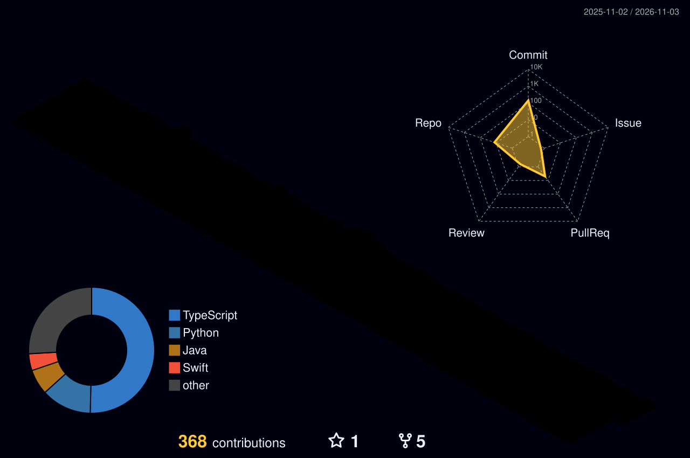

## Danuka Nalindu Ariyaratne

**Software Engineer** · Colombo, Sri Lanka

[LinkedIn](https://www.linkedin.com/in/danukanalindu/) · [GitHub](https://github.com/danuka-nalidu) · [Portfolio](https://danukanalindu.vercel.app) · [Medium](https://medium.com/@danukanalidu2002) · [Email](mailto:danukanalidu2002@gmail.com)

I build full-stack web applications and real-time backend systems, and I care about code that is tested, documented, and easy for the next developer to work with.

I spent a year as a Software Engineering Intern at Creative Software, working across Angular, Node.js, Socket.IO, REST APIs, automated testing, and CI/CD in an agile team.

That work included a real-time chat system serving 1,000+ concurrent connections, 25+ Swagger-documented APIs that cut onboarding time by 30%, and 85% test coverage across 24+ on-time sprint releases.

Beyond work, I build microservices, accessible mobile apps, and explainable AI research, which has been published at IEEE.

Current direction: backend engineering, event-driven architecture with Apache Kafka, applied AI, and software reliability.

  

### Selected work

My projects fall into three areas:

- **Real-time & full-stack products:** ReserveIt, a multi-service booking platform with real-time chat, 150+ automated tests, and Swagger-documented APIs.
- **Event-driven & distributed systems:** EasyEats, a food ordering platform built on microservices with an event-driven architecture, where Apache Kafka streams order events to decouple order processing from notifications, containerized with Docker.
- **Mobile & accessibility:** iShop, a text-to-speech shopping assistant for visually impaired users, and an EV charging app with a Kotlin client and a .NET/React admin system.

### Technical shape

**Frontend:**
Angular · React · TypeScript · JavaScript · HTML · SCSS · Tailwind CSS · Material UI

**Backend & architecture:**
Node.js · Express.js · REST APIs · Event-Driven Architecture · Apache Kafka · Microservices · WebSockets / Socket.IO · Java · .NET

**Mobile:**
Kotlin · Flutter

**Databases:**
MongoDB · MySQL · SQLite · Oracle

**DevOps & testing:**
Docker · CI/CD · Bitbucket Pipelines · Vercel · Jest · Jasmine · Karma · Cypress · Selenium

**Workflow:**
Git · Swagger · Postman · Jira · Confluence · Figma · Agile (Scrum)

### Research & publications

**A Multi-Stage Explainable AI Architecture for Stock Forecasting and Portfolio Decision Support**
Published at IEEE: 18th International Conference on Electronics, Computers and Artificial Intelligence (ECAI 2026).

### Education

BSc (Hons) in Information Technology, Specialised in Software Engineering · Sri Lanka Institute of Information Technology (SLIIT)
